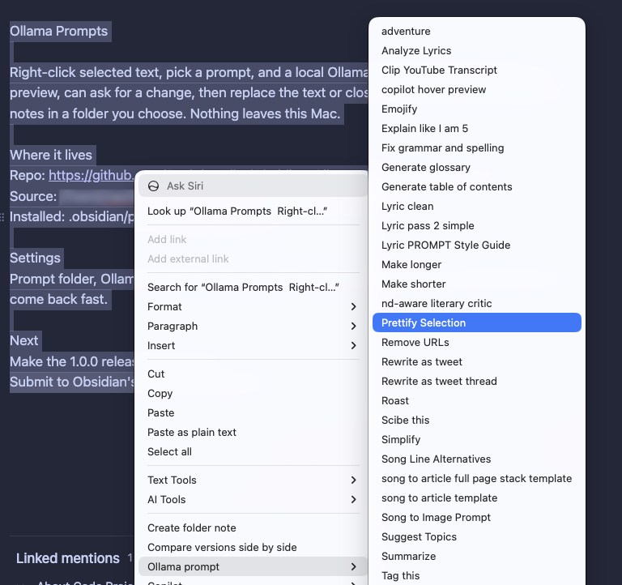
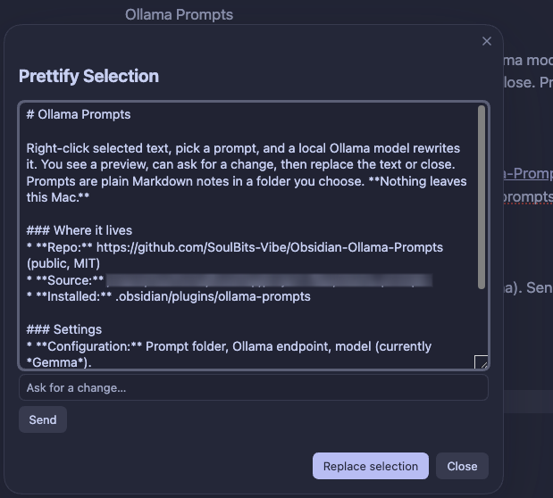
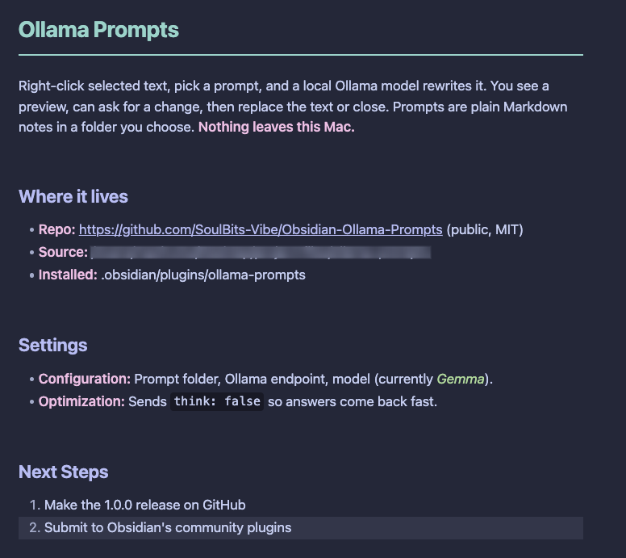
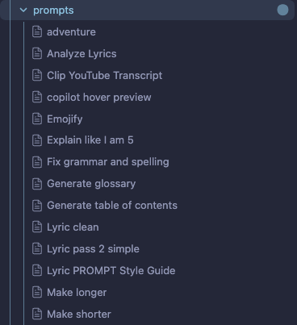
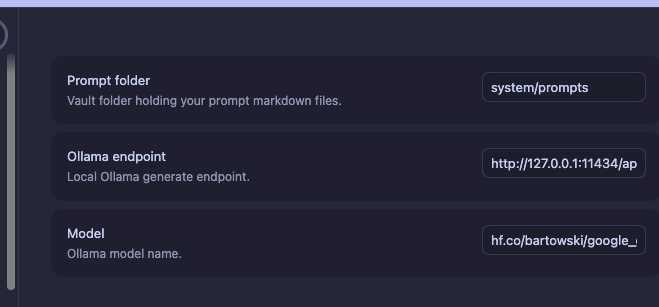

# Ollama Prompts

Run one of your own prompt files on the text you have selected in Obsidian, using a local [Ollama](https://ollama.com) model. Preview the result, ask for a change, then replace the selection or close the preview.

Prompts are ordinary Markdown notes in a vault folder. There is no chat box, no embedding database, and no cloud account.

## Screenshots

**Right-click menu, choose a prompt**



**Prompt returns a preview**



**Completed**



**Prompts are just markdown files**



**Simple settings**



## Requirements

- Obsidian desktop (this plugin is desktop-only)
- [Ollama](https://ollama.com) running on your computer
- At least one model pulled in Ollama (`ollama list` shows the exact names)

## Install

Until the plugin is in the Community plugins directory, install it manually:

1. In your vault, create `.obsidian/plugins/ollama-prompts/`.
2. Copy `main.js`, `manifest.json`, and `styles.css` into that folder. For a GitHub release, download those three files from the release assets.
3. In Obsidian: Settings → Community plugins → turn on Community plugins if needed, then enable **Ollama Prompts**.

To build from source:

```bash
npm install
npm run build
```

That writes `main.js`. Copy `main.js`, `manifest.json`, and `styles.css` into the plugin folder.

Use a separate vault when you are developing the plugin, not your main vault.

## Setup

1. Start Ollama and pull a model, for example `ollama pull gemma3`.
2. In Settings → Ollama Prompts:
   - **Prompt folder** — vault folder that holds your prompt notes. Default: `system/prompts`.
   - **Ollama endpoint** — default is `http://127.0.0.1:11434/api/generate`.
   - **Model** — the exact name from `ollama list`. Leave this empty until you set a model you actually have. A typo or a name that is not installed will show Ollama's error, not a generic "is Ollama running?" message.
3. Put prompt notes in that folder. Two starters are in [`examples/prompts`](examples/prompts). Copy them into your prompt folder, or write your own. The note body is the prompt; YAML frontmatter, if present, is ignored.

A settings example file is in [`data.local.json.example`](data.local.json.example). Do not commit your real `data.json`; it is personal.

## Use

1. Select text in the editor.
2. Right-click and choose **Ollama prompt**, then a prompt from the submenu. Or run the command **Run a prompt file on the selection** and pick a prompt in the fuzzy picker.
3. A preview opens with the model's rewrite. You can edit it, or type a change request and press **Send**.
4. Choose **Replace selection** or **Close**.

## Privacy

This plugin talks only to the Ollama endpoint you set. The default is a local server at `127.0.0.1`. The selected text and the chosen prompt are sent to that endpoint so the model can write a rewrite. Nothing is sent to the plugin author or to any third-party cloud service.

If you change the endpoint to a remote Ollama host, that host will receive the selected text and the prompt.

## Development

```bash
npm install
npm run dev
```

`npm run dev` rebuilds `main.js` when you change the TypeScript source in `src/`. Reload the plugin in Obsidian to try the change. `npm run lint` runs the Obsidian ESLint rules.

## License

This plugin is released under the [MIT License](LICENSE). Copyright (c) 2026 SoulBits Vibe.
